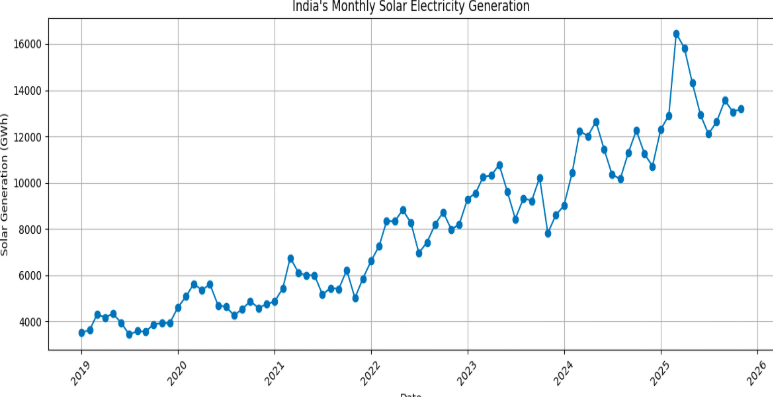
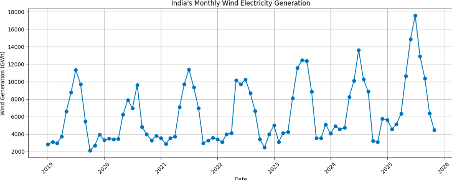
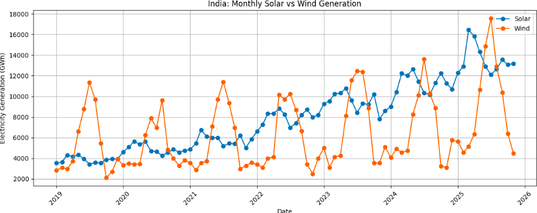

# Renewable-Energy-Performance-Analysis
Data analysis of India's renewable energy generation, installed capacity and CO2 emissions (2019–2025).
# Renewable Energy Performance Analysis | India (2019–2025)

## Project Overview

This project analyzes renewable energy performance in India from January 2019 to November 2025. It focuses on solar and wind electricity generation, installed capacity, state-level differences, renewable electricity share, and power-sector CO₂ emissions.

The objective is to evaluate how renewable energy has developed in India, compare the performance of solar and wind energy, identify leading states, and examine changes in electricity generation and carbon intensity.

The project uses Python and data analysis techniques to identify trends, calculate changes, and present meaningful insights through visualizations.

---

## Problem Statement

India's electricity sector is undergoing changes as renewable energy becomes an increasingly important source of electricity generation.

To understand this transition, it is important to examine installed capacity, actual electricity generation, renewable energy contribution, differences in state-level performance, and power-sector emissions.

This project investigates these indicators using India's monthly electricity data from 2019 to November 2025.

## Project Objectives

- Analyze monthly and annual solar and wind electricity generation.
- Compare solar and wind generation trends and growth.
- Identify the top 10 solar- and wind-generating states in 2024.
- Examine changes in installed solar and wind capacity.
- Analyze the renewable share of total electricity generation.
- Evaluate changes in total power-sector CO₂ emissions.
- Examine changes in CO₂ intensity.
- Develop data-based findings and recommendations.

---

## Dataset and Scope

**Dataset:** India Monthly Electricity Data  
**Publisher:** Ember  
**Source:** [Ember – India Electricity Data](https://ember-energy.org/data/india-electricity-data/)  
**Working file:** `india_monthly_full_release_long_format_cleaned.csv`  
**Analysis period:** January 2019 – November 2025  
**Geographical coverage:** India, including national and state-level records.

The dataset contains 238,200 records, according to the project report.

Important fields include:

- Country and Country Code
- State and State Code
- State Type
- Date
- Category and Subcategory
- Variable
- Unit and Value
- Year-on-Year Absolute Change
- Year-on-Year Percentage Change

The analysis covers capacity, electricity generation, and power-sector emissions.

**Note:** 2025 data is available only through November and is treated as a partial year.

---

## Technology Used

| Technology | Purpose |
|---|---|
| Python | Data preparation, calculations and analysis |
| Google Colab | Cloud-based Python environment |
| Pandas | Data cleaning, filtering and summarization |
| NumPy | Numerical operations and percentage calculations |
| Matplotlib | Data visualization |
| Microsoft Excel | Reviewing analytical outputs and summary tables |
| CSV | Data storage and exchange |
| GitHub | Project documentation and portfolio presentation |

---

## Data Validation and Cleaning

The dataset was reviewed and prepared for analysis using Python and Pandas.

The main preparation and validation activities included:

- Inspecting dataset structure, columns and data types.
- Checking date formats and preparing date fields.
- Checking missing values.
- Checking duplicate records using country, state, date, category, subcategory, variable and unit fields.
- Separating national-level and state-level observations.
- Reviewing category, subcategory, variable and unit consistency.
- Selecting records relevant to generation, capacity and emissions.
- Recalculating percentage changes and comparing key reported indicators.
- Comparing January–November 2025 with January–November 2024 to ensure consistent reporting periods.

The report records no duplicate records using the selected analytical key. Missing values and recorded zero values were treated as distinct conditions.

---

## Methodology

The project follows a descriptive and comparative data analysis approach.

**1. Data Collection and Preparation:** The cleaned CSV dataset was imported into Google Colab using Python and Pandas.

**2. Data Cleaning:** Data types, date formats, missing values, duplicate records and category labels were reviewed.

**3. Descriptive and Time-Series Analysis:** Monthly and annual trends were examined for generation, capacity, renewable electricity share, emissions and CO₂ intensity.

**4. Comparative Analysis:** Solar and wind generation were compared using total generation, annual summaries and matched-period growth.

**5. State-Level Analysis:** State-level generation values for 2024 were aggregated and ranked to identify the leading solar and wind states.

**6. Percentage-Change Calculation:** Percentage changes were calculated using:

`((Final Value - Initial Value) / Initial Value) × 100`

For renewable electricity share, the difference was also expressed in percentage points.

**7. Visualization:** Trend charts, comparison charts and state-level bar charts were created using Matplotlib.

**8. Sustainability Interpretation:** Total CO₂ emissions and CO₂ intensity were examined separately to understand changes in overall emissions and emissions per unit of electricity.

---

## Analysis Performed

### 1. Solar and Wind Generation Analysis

Analyzed monthly and annual solar and wind electricity generation across the available period.

**Monthly Solar Generation**

**Monthly Wind Generation**

*Add your monthly wind generation chart here.*

**Solar vs Wind Generation Comparison**

*Add your solar and wind comparison chart here.*

### 2. State-Level Analysis (2024)

Compared solar and wind electricity generation across Indian states to identify the leading contributors.

**Top 10 Solar-Generating States**

*Add your top 10 solar states chart here.*

**Top 10 Wind-Generating States**

*Add your top 10 wind states chart here.*

### 3. Installed Capacity Analysis

Examined changes in installed solar and wind capacity between the available starting and latest reporting dates.

*Add your installed capacity chart here.*

### 4. Renewable Electricity Share

Analyzed the percentage contribution of renewable energy to national electricity generation over time.

*Add your renewable electricity share chart here.*

### 5. Emissions and Sustainability Analysis

Examined total power-sector CO₂ emissions and CO₂ intensity to understand their changes over the study period.

**Total Power-Sector CO₂ Emissions**

*Add your total emissions chart here.*

**CO₂ Intensity**

*Add your CO₂ intensity chart here.*

---

## Key Findings

### Solar and Wind Generation

- Total solar generation across the available period was **664,860.01 GWh**.
- Total wind generation was **524,529.16 GWh**.
- Solar represented **55.9%** and wind represented **44.1%** of their combined generation.
- Solar generation showed a strong upward trend during the study period.

*The 55.9% and 44.1% figures refer to combined solar and wind generation, not total Indian electricity generation.*

### Matched-Period Generation Growth

Comparing January–November 2025 with January–November 2024:

| Energy Source | Jan–Nov 2024 | Jan–Nov 2025 | Growth |
|---|---:|---:|---:|
| Solar | 123,087.84 GWh | 149,238.23 GWh | +21.25% |
| Wind | 75,796.68 GWh | 98,997.47 GWh | +30.61% |

### State-Level Performance

- Rajasthan was the leading solar-generating state in 2024, with **46,039.53 GWh**.
- Gujarat was the leading wind-generating state, with **24,644.66 GWh**.
- Karnataka and Tamil Nadu were among the major contributors to both solar and wind generation.

### Installed Capacity

| Energy Source | March 2019 | November 2025 | Growth |
|---|---:|---:|---:|
| Solar | 28,225.72 MW | 132,594.98 MW | +369.77% |
| Wind | 35,625.96 MW | 53,981.70 MW | +51.52% |

The reported starting dates are preserved. Capacity measures installed power capability, not electricity generated.

### Renewable Electricity Share

- Renewable electricity share increased from **15.24% in January 2019** to **23.01% in November 2025**.
- This represents an increase of **7.77 percentage points**.

### Power-Sector Emissions and CO₂ Intensity

- Total power-sector CO₂ emissions increased from **73,799.11 ktCO₂** to **81,078.26 ktCO₂**, an increase of **9.86%**.
- CO₂ intensity decreased from **669.27 gCO₂/kWh** to **613.65 gCO₂/kWh**, a reduction of **8.31%**.

These findings show that total emissions increased while emissions per unit of electricity decreased. The analysis does not establish that renewable energy growth caused these changes.

---

## Recommendations

Based on the findings, the project identifies the following recommendations:

- Continue expanding solar and wind energy infrastructure.
- Improve electricity transmission networks to support renewable energy integration.
- Invest in energy storage and grid flexibility to manage variations in renewable generation.
- Use state-specific planning based on renewable resource potential and infrastructure.
- Monitor installed capacity and actual electricity generation together.
- Track total CO₂ emissions and CO₂ intensity as separate sustainability indicators.
- Include additional data on electricity demand, fossil-fuel mix, weather, storage and curtailment for deeper analysis.
- Verify missing observations and zero values against the original data source.

---

## Limitations

- The dataset covers January 2019 to November 2025; 2025 is not a complete year.
- Endpoint comparisons do not describe every monthly change and may be affected by seasonality.
- Installed capacity and electricity generation measure different things.
- Descriptive analysis cannot establish causal relationships.
- State rankings may be affected by missing values, source definitions and reporting conventions.
- The reported zero for Bihar wind generation requires verification before drawing conclusions.
- The analysis does not include forecasting or causal modelling.
- The original CSV, notebook, retrieval date and licence details should be retained and confirmed from the source when publishing the project.

---

## Conclusion

The analysis of renewable energy performance in India from January 2019 to November 2025 shows significant progress in the growth of renewable energy generation and installed capacity. The share of renewable energy in electricity generation increased from 15.24% in January 2019 to 23.01% in November 2025, indicating a growing contribution of renewable sources to India's electricity supply.
The study also shows substantial growth in solar and wind energy. Solar installed capacity increased from 28,225.72 MW in March 2019 to 132,594.98 MW in November 2025, while wind installed capacity increased from 35,625.96 MW to 53,981.70 MW. Furthermore, a comparison of January–November data shows that solar generation increased by 21.25% and wind generation by 30.61% in 2025 compared with the same period in 2024.
The analysis of carbon emissions reveals that total power-sector CO₂ emissions increased from 73,799.11 ktCO₂ in January 2019 to 81,078.26 ktCO₂ in November 2025. However, CO₂ intensity decreased from 669.27 to 613.65 gCO₂/kWh. This indicates that the emissions intensity of electricity generation declined, even though total emissions increased over the selected period. Therefore, the results show progress in renewable energy adoption but do not establish that renewable energy growth alone caused the reduction in CO₂ intensity.
In conclusion, renewable energy is playing an increasingly important role in India's electricity sector. Continued investment in solar and wind power, improvements in grid infrastructure, energy storage, and effective energy policies can support further progress towards a cleaner and more sustainable electricity system. This study provides a data-based overview of renewable energy trends in India during the selected period

---

## Skills Demonstrated

Python | Pandas | NumPy | Data Cleaning | Data Validation | Exploratory Data Analysis | Time-Series Analysis | Comparative Analysis | Matplotlib | Microsoft Excel | Data Visualization | Analytical Thinking | Data Storytelling

